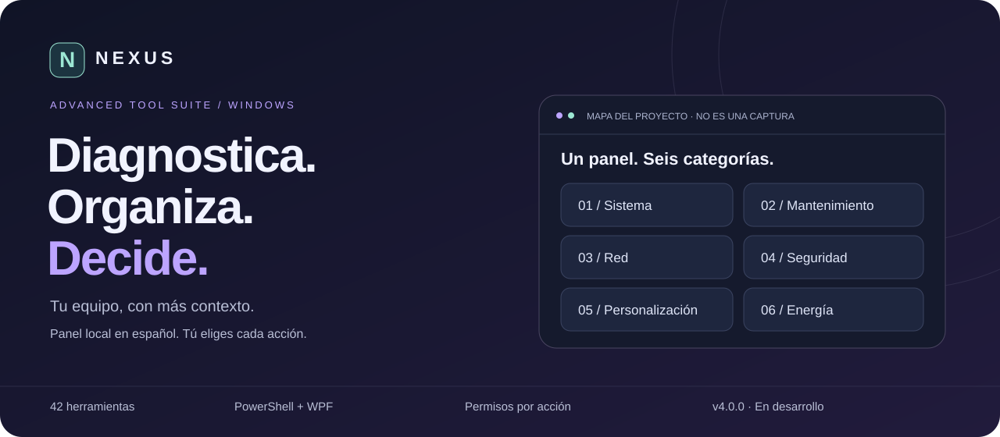

<div align="center">


# NEXUS · Advanced Tool Suite

### Diagnostica. Organiza. Decide.

**42 herramientas de Windows en un panel local, claro y en español.**
**Diagnósticos, inventarios, favoritos y plugins declarativos — con permisos por acción.**

📖 **[Manual de usuario](MANUAL.md) · [Guía de primera sesión](site/uso.html) · [Inicio rápido](LEEME-PRIMERO.md) · [Analizador de cobros](Cobros/README.md) · [Novedades](CHANGELOG.md) · [Web del proyecto — fuentes](site/index.html)**

🌐 **Documentación:** Español · [English](docs/readme/README_en.md) · [Português](docs/readme/README_pt-BR.md)
La interfaz de la aplicación está en español; las traducciones del panel siguen en la hoja de ruta.

**Windows 10/11 x64 · Windows PowerShell 5.1 · .NET Framework 4.8 · MIT**

[Resumen](#resumen) · [Ecosistema](#ecosistema) · [Funciones](#funciones) · [Cobros](#analizador-de-cobros) · [Vista del proyecto](#vista-del-proyecto) · [Requisitos](#requisitos) · [Inicio rápido](#inicio-rápido) · [Permisos](#permisos-y-uso-seguro) · [Documentación](#documentación-y-web) · [Preguntas frecuentes](#preguntas-frecuentes) · [Seguridad](#privacidad-y-registros) · [Licencia](#licencia)

</div>



> [!TIP]
> **¿Ya lo instalaste?** Ábrelo desde **Inicio → Advanced Tool Suite**. No vuelvas a ejecutar el instalador para usarlo. Sigue la [primera sesión recomendada](site/uso.html) o el [manual](MANUAL.md).

> **Sitio web:** el diseño está en `site/`; la publicación en GitHub Pages sigue pendiente de configuración/verificación. Los enlaces HTML anteriores muestran los archivos en GitHub; no se presentan como una web ya desplegada. [Cómo publicar](docs/SEGURIDAD-REPOSITORIO.md).

> **Estado honesto:** hay código, documentación y pruebas automatizadas. Las verificaciones estáticas no certifican que WPF, los cambios administrativos o los paquetes EXE/MSI funcionen correctamente en tu equipo. Consulta los resultados reales de [CI](https://github.com/yhquintero/Advanced_Tool_Suite/actions) y la [matriz Windows](docs/PRUEBAS-WINDOWS.md). No se promete seguridad absoluta.

## Resumen

Advanced Tool Suite organiza diagnósticos y accesos administrativos de Windows en un panel local: tarjetas redondeadas, temas, buscador, favoritos, actividad y estado del equipo. No es un antivirus, un sistema de autenticación empresarial ni un servicio de administración remota.

## Ecosistema

| Pieza | Para qué sirve | Dónde funciona |
| --- | --- | --- |
| Aplicación NEXUS | Ejecutar diagnósticos y abrir herramientas | Windows, localmente |
| Web documental | Conocer funciones, requisitos y pasos | Navegador; no administra el equipo |
| Autoextraíble | Reconstruir las fuentes y recursos sin descargas | Windows PowerShell |
| Analizador de cobros | Revisar un Excel de pagos: quién no pagó, quién pagó fuera de plazo y gráficos dinámicos | Navegador, sin conexión; el archivo no sale del equipo |
| Repositorio | Revisar código, pruebas, manual y cambios | GitHub o copia local |

## Funciones

| Incluido en el código | Alcance |
| --- | --- |
| Panel WPF en español | 42 herramientas por categorías; cuatro temas y modo compacto |
| Diagnóstico | CPU/RAM/espacio, información, red, inventarios y salud reportada por Windows |
| Controles por acción | Confirmaciones y UAC cuando corresponde, no elevación global |
| Registro operativo | Actividad exportable, auditoría y rotación; **no inmutables** |
| Plugins v4, fase inicial | JSON de diagnósticos permitidos; sin ejecutar PS1/DLL/EXE de terceros |
| Autoextraíble | Un `.ps1` crea las fuentes y recursos completos en una carpeta nueva |
| Distribución | Recetas EXE/MSI y firma opcional; no implica paquetes compilados/firmados |

**Todavía planificado:** i18n ES/EN/PT, gráficas, editor visual de temas, AD, workflows y host aislado de código externo. [Hoja de ruta](docs/ROADMAP-v4.0.0.md).

## Analizador de cobros

[`Cobros/AnalizadorCobros.html`](Cobros/README.md) es un panel de un solo archivo. Se abre con doble clic y lee el Excel de pagos de los contribuyentes (`.xls`, `.xlsx` o CSV) **dentro del navegador**, sin conexión ni instalación. Muestra:

- quién no pagó cada mes;
- quién pagó después de los primeros **10 días hábiles**, con feriados de Cuba editables;
- tablas y gráficos dinámicos del Importe ($).

Es independiente del panel WPF y no forma parte de las 42 herramientas. No subas Excel de clientes al repositorio: es público, y `.gitignore` los excluye. [Guía y reglas](Cobros/README.md).

## Vista del proyecto

El banner es un **mapa conceptual original**, no una captura ni una lectura de tu ordenador. La [portada HTML](site/index.html) incluye una ilustración del panel y un catálogo desplegable sincronizado con los 42 IDs del PS1. No se ofrecen capturas o vídeos ficticios.

## Requisitos

- Windows 10/11 **x64 de escritorio**, Windows PowerShell **5.1** y .NET Framework **4.8**.
- Usuario estándar recomendado; concede UAC solo para una acción que comprendas.
- No compatible con Linux, macOS, Server Core ni PowerShell 7 como plataforma soportada.

## Inicio rápido

### Opción A · un único archivo

Obtén [`Releases/AdvancedToolSuite-v4.0.0-setup.ps1`](Releases/AdvancedToolSuite-v4.0.0-setup.ps1) de una revisión que hayas verificado. Guarda el fichero y abre Windows PowerShell en esa carpeta:

```powershell
# Comprueba el contenido sin crear archivos
powershell.exe -NoProfile -File .\AdvancedToolSuite-v4.0.0-setup.ps1 -ValidateOnly

# Crea el proyecto en una carpeta NUEVA y abre el panel
powershell.exe -NoProfile -File .\AdvancedToolSuite-v4.0.0-setup.ps1 -Launch
```

Sin `-Launch` solo extrae. No descarga dependencias, no instala tareas/registro y no sobrescribe un destino existente. El fichero no está firmado aquí: sus hashes detectan incoherencias, **no autentican a quien lo distribuye**. [Instrucciones completas](LEEME-PRIMERO.md).

### Opción B · desde las fuentes

```powershell
powershell.exe -NoProfile -STA -File .\Tool\AdvancedToolSuite.ps1
```

También puedes abrir `Tool/Iniciar.cmd`. El PS1 principal contiene XAML e iconos y no requiere módulos externos para mostrar el panel. No uses el `.bat` heredado: se conserva como referencia y no incorpora las protecciones de la interfaz nueva.

Si una política bloquea el script, consulta a tu administrador. Revisa origen y contenido antes de desbloquear un archivo descargado. No desactives antivirus, SmartScreen o políticas corporativas para evitar avisos. Nunca ejecutes descargas mediante `iex` ni comandos de instalación opacos.

### Opción C · instalar desde el repositorio

```powershell
.\install.ps1 -WhatIf
.\install.ps1
```

Prepara un Portable nuevo, valida sus hashes e instala para tu usuario. Luego abre **Inicio → Advanced Tool Suite**; el instalador no es el lanzador diario. [Si la instalación falla](docs/SOLUCION-INSTALACION-REGISTRO.md).

## Permisos y uso seguro

| Acción | Recomendación |
| --- | --- |
| Abrir el panel | Usuario estándar; no elevar toda la aplicación |
| Primera sesión | Ajustes → Solo lectura; empezar con información del sistema, memoria e IP |
| Acción con UAC | Revisar y autorizar únicamente esa operación |
| Cambios delicados | Copia de seguridad y prueba previa en VM |
| Plugins | Importar inactivo, revisar, aprobar y ejecutar explícitamente |

No hay roles empresariales como administrador/cajero: son permisos de Windows y controles locales, no un sistema multiusuario de negocio.

### Antes de realizar cambios

- Haz copia de seguridad y prueba operaciones delicadas en una VM con instantánea.
- Convertir FAT32 a NTFS no se revierte con el botón Deshacer ni con un punto de restauración.
- Apagar/reiniciar es inmediato tras confirmar. Desactivar firewall reduce la protección del equipo.
- Deshacer cubre **un solo valor interno** de Registro; no cambios externos ni operaciones generales.
- Puntos de restauración necesitan Protección del sistema y pueden estar limitados por Windows.
- Solo lectura y clave local previenen accidentes; una persona con acceso al perfil/código puede modificarlos. **No son fronteras de privilegios.**
- Cerrar el panel no cancela automáticamente herramientas externas. `DISPATCHED` significa enviado, no completado.

Más detalles en [SECURITY.md](SECURITY.md) y [MANUAL.md](MANUAL.md).

## Privacidad y registros

La suite no implementa telemetría. Ping y herramientas de Windows pueden generar tráfico cuando las solicitas. Los inventarios pueden incluir usuario, red y números de serie: revisa y anonimiza antes de compartirlos.

| Ubicación | Contenido |
| --- | --- |
| `%LOCALAPPDATA%\AdvancedToolSuite` | Preferencias, actividad, auditoría, versiones, protección local y plugins |
| `Documentos\AdvancedToolSuite\Reportes` | Inventarios manuales |
| `Documentos\AdvancedToolSuite\Programados` | Informes de tareas `ATS-Informe-*` |
| `C:\REPORTE\audit.log` | Copia adicional solo si hay permisos; no se cambian ACL |

Actividad/auditoría rotan al superar 5 MiB, con cinco copias. Los logs son editables y no garantizan cumplimiento normativo. La desinstalación conserva datos e informes deliberadamente. [Política de seguridad y exposición de datos](SECURITY.md).

## Instalación, compilación y firma

`install.ps1` reconoce las fuentes del repositorio y prepara un Portable nuevo antes de instalar. También admite paquetes Portable/Exe ya generados mediante `-SourceDirectory`. Instala por usuario con recibo, hashes y `-WhatIf`; `uninstall.ps1` conserva datos e informes. No mezcles MSI y scripts en el mismo destino.

```powershell
.\packaging\Build-Release.ps1 -Format Portable
# EXE: ps2exe revisado + mt.exe del SDK; MSI: además WiX
.\packaging\Build-Release.ps1 -Format Exe
```

[BUILD.md](BUILD.md) explica requisitos, manifiesto `asInvoker`, Authenticode, sello de tiempo y límites. No se incluyen certificados privados ni se afirma que existan binarios firmados publicados.

## Pruebas y calidad

```sh
python packaging/Build-Bootstrap.py
python -m unittest discover -s tests -v
```

En Windows PowerShell 5.1:

```powershell
.\tests\Validar-PowerShell.ps1
.\tests\Probar-Contratos.ps1
.\tests\Probar-Plugins.ps1
.\tests\Run-Pester.ps1
powershell.exe -NoProfile -STA -File .\Tool\AdvancedToolSuite.ps1 -SmokeTest
```

`unittest` incluye el Analizador de cobros. Con Node.js 18 o superior también ejecuta `tests/cobros-harness.mjs`; sin Node, esa parte se omite.

La suite Pester define 43 casos y su runner exige 43/43. Eso no significa que hayan pasado en todas las máquinas o revisiones. CI usa permisos mínimos y acciones fijadas por SHA; consulta sus resultados, no solo una insignia. [Validaciones y límites](docs/REVISION-4.0.0.md).

## Documentación y web

- [Primera ejecución](LEEME-PRIMERO.md) · [Manual](MANUAL.md) · [Construcción](BUILD.md)
- [Plugins](Plugins/README.md) · [Analizador de cobros](Cobros/README.md) · [Versiones](CHANGELOG.md) · [Roadmap](docs/ROADMAP-v4.0.0.md)
- [Contribuciones](CONTRIBUTING.md) · [Seguridad](SECURITY.md) · [Licencias de terceros](THIRD_PARTY_NOTICES.md)
- [Web estática y configuración GitHub pendiente](docs/SEGURIDAD-REPOSITORIO.md)
- [Revisión del rediseño web y mantenimiento del catálogo](docs/REVISION-WEB.md)

La web de presentación está en `site/`, con portada, catálogo desplegable de las 42 herramientas en 6 categorías, guía local y página de seguridad. Ofrece temas claro/oscuro según el sistema y no contiene JavaScript, formularios, cookies, analítica ni recursos remotos. Su publicación en GitHub Pages requiere habilitación y despliegue; no se anuncia como activa sin comprobarlo. El enlace Website del About propuesto apunta al README mientras tanto.

## Preguntas frecuentes

<details>
<summary><strong>¿Cómo lo abro después de instalarlo?</strong></summary>

Desde Inicio → Advanced Tool Suite, sin elevar el panel. Si necesitas abrirlo desde consola:

```powershell
powershell.exe -NoProfile -STA -File "$env:LOCALAPPDATA\Programs\AdvancedToolSuite\AdvancedToolSuite.ps1"
```

</details>

<details>
<summary><strong>¿La web ejecuta herramientas o funciona como una PWA?</strong></summary>

No. Es documentación estática; no administra Windows y no se presenta como una PWA. La aplicación es WPF local. La extracción y apertura no requieren descargas; las pruebas de conectividad sí usan red cuando las solicitas.

</details>

<details>
<summary><strong>¿Necesito administrador? ¿Puedo deshacer todo?</strong></summary>

Abre como usuario estándar y autoriza UAC por acción. Deshacer solo cubre determinados ajustes internos del Registro; no revierte cambios generales, conversiones de disco o borrados. Conserva copias de seguridad.

</details>

<details>
<summary><strong>¿Hay EXE, MSI o paquetes firmados listos?</strong></summary>

Hay recetas de construcción y firma, no una promesa de binarios publicados. La advertencia SIN FIRMA describe el paquete generado; no es un error de instalación. Los hashes no autentican al editor.

</details>

<details>
<summary><strong>¿Puedo usar plugins de terceros o cambiar el idioma?</strong></summary>

Los plugins actuales son JSON de diagnósticos permitidos, no código arbitrario. El panel está en español; la documentación resumida tiene versiones inglesa y portuguesa. La traducción de la aplicación sigue planificada.

</details>

## Licencia

[MIT](LICENSE), con [traducción informativa al español](LICENSE.es.md). El texto canónico facilita su identificación por GitHub. Los mantenedores deben confirmar derechos y atribuciones de contribuciones heredadas antes de distribuir. MIT no relicencia componentes de Microsoft ni dependencias externas y no ofrece garantía de seguridad.

## Colaborar o reportar problemas

Para fallos normales usa [Issues](https://github.com/yhquintero/Advanced_Tool_Suite/issues) y las plantillas, sin datos sensibles. **No publiques vulnerabilidades explotables, claves, contraseñas ni inventarios completos**: sigue [SECURITY.md](SECURITY.md). Las PR deben incluir pruebas, documentación y regeneración del autoextraíble cuando cambian sus fuentes.
